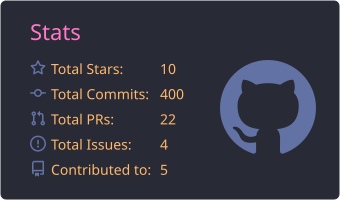
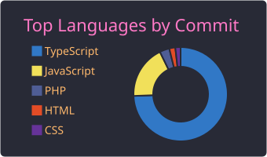

## Olá! Eu sou o Thiago Trindade 👋

Desenvolvedor **full-stack** em **Einstein Hospital Israelita**, em São Paulo. Nas horas vagas, construo jogos, apps desktop e pipelines com IA.

### 🚀 Projetos em destaque

- **[Treinador FC](https://github.com/TrindadeThiago/brasfoot-like)**: jogo de técnico de futebol no navegador, com carreira sem fim, acesso e rebaixamento, mercado e diretoria. Funciona offline. *Next.js + motor em TypeScript.*
- **[screen-share](https://github.com/TrindadeThiago/screen-share)**: alternativa self-hosted ao compartilhamento de tela do Discord. Transmite tela, som e voz sem precisar de conta. *Electron + LiveKit.*
- **[reddit-story-pipeline](https://github.com/TrindadeThiago/reddit-story-pipeline)**: transforma posts do Reddit em vídeos verticais, com narração por TTS (Piper/ElevenLabs), legendas via Whisper e revisão manual antes de publicar.

### 🛠️ Tecnologias

  &nbsp;
  &nbsp;
  &nbsp;
  &nbsp;
  &nbsp;
  &nbsp;
  &nbsp;
  

### 📊 Estatísticas

  
  

### 📫 Contato

  
  
  
  

---

<picture>
  <source media="(prefers-color-scheme: dark)" srcset="https://raw.githubusercontent.com/TrindadeThiago/TrindadeThiago/output/github-snake-dark.svg">
  
</picture>
